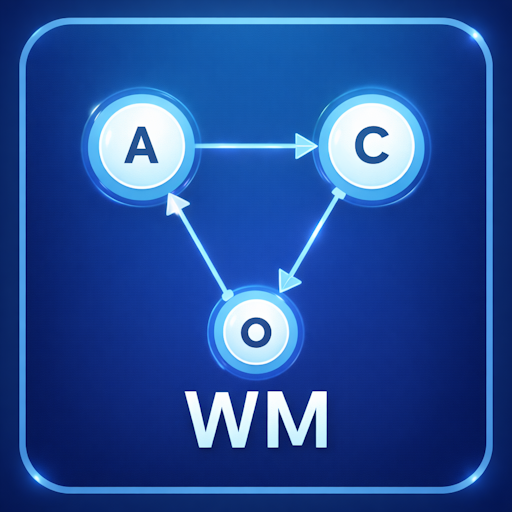

<p align="center">
  
</p>

<h1 align="center">Workflow Manager for Farming Simulator 25</h1>

<p align="center">
  Chain <b>AutoDrive</b> routes and <b>Courseplay</b> courses into one automated job:<br>
  drive to the field, work it, drive to the next one, and keep going without you.
</p>

<p align="center">
  <a href="https://github.com/CSchoch/FS25_WorkflowManager/releases/latest"></a>
  <a href="https://github.com/CSchoch/FS25_WorkflowManager/releases"></a>
  
  
  <a href="https://cschoch.github.io/FS25_WorkflowManagerDocs/"></a>
  <a href="LICENSE"></a>
</p>

<p align="center">
  <a href="https://github.com/CSchoch/FS25_WorkflowManager/releases/latest"><b>Download</b></a> ·
  <a href="https://cschoch.github.io/FS25_WorkflowManagerDocs/"><b>Documentation</b></a> ·
  <a href="https://cschoch.github.io/FS25_WorkflowManagerWebeditor/"><b>Web Editor</b></a> ·
  <a href="https://github.com/CSchoch/FS25_WorkflowManager/issues/new/choose"><b>Report a bug</b></a>
</p>

---

<p align="center">
  
</p>

## What it does

AutoDrive moves vehicles between places. Courseplay works fields. Neither one knows what comes
next. Workflow Manager tells them: you build a workflow once, assign it to a vehicle, press
Start, and the vehicle runs through every step on its own.

A typical multi-field harvest:

```
1. AutoDrive   drive to Field 1
2. Courseplay  harvest Field 1
3. AutoDrive   drive to Field 2
4. Courseplay  harvest Field 2
   ... as many fields as you like
```

## Features

- **Multi-step workflows**: any number of AutoDrive and Courseplay steps, in any order
- **Step types**: AutoDrive (Drive To, Pickup & Deliver, Deliver, Load, Unload), Courseplay
  (Field Work, Bale Collect), Park, Refuel, Repair, and the sync markers *Wait for Leader* and
  *Unlock Follower*
- **Support vehicles**: a grain cart that follows the combine, unloads it, delivers to the silo
  and moves on to the next field when the combine does
- **Leader and follower vehicles**: a follower waits at a marker step until its leader releases it
- **Seed type per field-work step**: the seeder is switched automatically
- **In-vehicle HUD**: current step, previous / pause / resume / stop / next, draggable
- **Save and load**: workflows are saved with the savegame and resume after loading. Courseplay
  continues from the last waypoint instead of starting the field over
- **Multiplayer**: server-authoritative, so every player sees the same state
- **Web editor**: edit workflows in the browser, even while the game runs
- **Keyboard shortcuts** in every dialog
- **English and German** in game and in the docs

<table>
  <tr>
    <td></td>
    <td></td>
  </tr>
  <tr>
    <td align="center">Workflow list</td>
    <td align="center">HUD while a workflow runs</td>
  </tr>
  <tr>
    <td colspan="2"></td>
  </tr>
  <tr>
    <td colspan="2" align="center">Web editor</td>
  </tr>
</table>

## Requirements

| Mod | Needed |
| --- | --- |
| [Courseplay](https://github.com/Courseplay/Courseplay_FS25) | Always |
| [AutoDrive](https://github.com/Stephan-S/FS25_AutoDrive) | Only for workflows with AutoDrive, Park, Refuel or Repair steps |

## Installation

1. Download `FS25_WorkflowManager.zip` from the
   [latest release](https://github.com/CSchoch/FS25_WorkflowManager/releases/latest).
2. Put the zip, unextracted, into your mods folder:
   `Documents\My Games\FarmingSimulator2025\mods`
3. Activate **Workflow Manager** (plus Courseplay, and AutoDrive if you need it) for your savegame.

Then follow [Getting started](https://cschoch.github.io/FS25_WorkflowManagerDocs/docs/getting-started).

## Default hotkeys

| Key | Action |
| --- | --- |
| Left Alt + W | Open Workflow Manager (on foot or in a vehicle) |
| Left Alt + H | Show / hide the HUD (in a vehicle) |

All keys can be changed in the game's Controls settings. Dialog shortcuts are listed in the
[documentation](https://cschoch.github.io/FS25_WorkflowManagerDocs/).

## Help and feedback

- Questions and problems: check the
  [FAQ](https://cschoch.github.io/FS25_WorkflowManagerDocs/docs/faq) and
  [Troubleshooting](https://cschoch.github.io/FS25_WorkflowManagerDocs/docs/troubleshooting) first
- Bugs: [open a bug report](https://github.com/CSchoch/FS25_WorkflowManager/issues/new?template=bug_report.yml)
  and attach your `log.txt`
- Ideas: [suggest a feature](https://github.com/CSchoch/FS25_WorkflowManager/issues/new?template=feature_request.yml)

## Development

The mod is plain Lua, with no build step. Tests run on Lua 5.1 against stubbed game, AutoDrive
and Courseplay APIs:

```powershell
& "C:\Program Files (x86)\Lua\5.1\lua.exe" tests\run_tests.lua
```

`create_release.bat` builds the release zip from the files the game needs.

| Path | Contents |
| --- | --- |
| `src/` | Mod code: manager, executor, AutoDrive / Courseplay integration, GUI, network events |
| `xml/gui/` | Dialog layouts |
| `translations/` | English and German texts |
| `tests/` | Spec files and the test runner |
| `docs/` | Developer notes (AutoDrive / Courseplay API analysis, multiplayer and queue concepts) |
| `website/` | Documentation site, a submodule ([FS25_WorkflowManagerDocs](https://github.com/CSchoch/FS25_WorkflowManagerDocs)) |
| `webeditor/` | Browser editor, a submodule ([FS25_WorkflowManagerWebeditor](https://github.com/CSchoch/FS25_WorkflowManagerWebeditor)) |

Clone with submodules: `git clone --recurse-submodules https://github.com/CSchoch/FS25_WorkflowManager.git`

## Credits

Workflow Manager builds on the work of the
[AutoDrive](https://github.com/Stephan-S/FS25_AutoDrive) and
[Courseplay](https://github.com/Courseplay/Courseplay_FS25) teams.

## License

[MIT](LICENSE) © 2026 Christian Schoch
